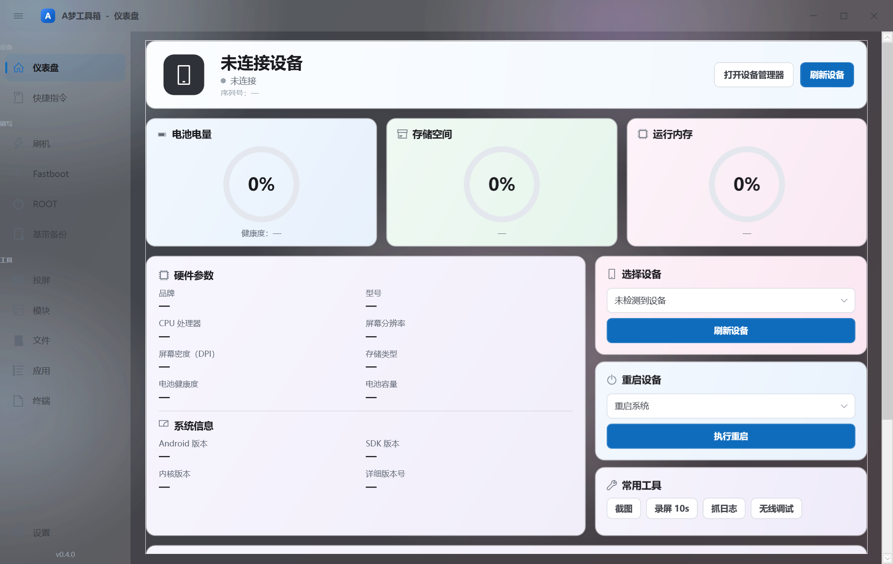

# A梦工具箱

面向 Android 设备的 Windows 桌面工具箱：设备信息、刷机 / Fastboot、ROOT 辅助、投屏、模块、应用管理、终端。

界面是原生 WPF 窗口（不是网页）；内置 `adb`、`fastboot` 与 `scrcpy`，安装后即可使用。



## 功能

| 页面 | 能做什么 |
|---|---|
| 仪表盘 | 设备信息、电量 / 存储 / 内存环形指标、详细参数、重启、截图、录屏、抓日志、无线调试 |
| 快捷指令 | 重启到系统 / Recovery / Bootloader / Fastbootd、屏幕常亮、动画缩放、触摸显示、重启 ADB、打开设备管理器 |
| 刷机 | 品牌线刷（单分区镜像）、小米整包线刷（`flash_all*.bat`）、Bootloader 解锁 / 回锁、双清、扩展功能、分区表备份还原 |
| Fastboot | 检测设备、镜像预检、刷入分区、重启到系统 / bootloader / fastbootd |
| ROOT | root 状态、备份 boot / init_boot / vbmeta、打开 Magisk / KernelSU、修补流程说明 |
| 投屏 | 内置 scrcpy，分辨率 / 码率 / 窗口置顶 |
| 基带备份 | modem / fsg / persist 等分区备份与还原 |
| 模块 | Magisk / KernelSU 模块启停 |
| 应用 | 全部 / 第三方应用、冻结、解冻、清数据、提取 APK、卸载、安装 APK |
| 终端 | 设备 `adb shell` 或本机 CMD，root 开关、历史记录 |
| 设置 | 运行环境、版本、作者与开源项目 |

## 下载

从 [Releases](../../releases) 下载：

- `A梦工具箱-x.y.z-安装程序.exe`：NSIS 安装包，安装到 Program Files，带开始菜单 / 桌面快捷方式和卸载项；
- `A梦工具箱-x.y.z.zip`：绿色版，解压运行 `A梦工具箱.exe`。

程序需要 **Windows 10/11 + .NET Framework 4.8**（系统自带），运行时需要管理员权限。

## 从源码构建

```powershell
# 1. 准备平台工具（adb / fastboot）到根目录 platform-tools/ 或 PATH
# 2. 准备 scrcpy 到 desktop/tools/（可用下面的脚本自动下载）
python desktop/fetch_tools.py

# 3. 编译
python desktop/build.py

# 4. 安装包（需要 NSIS 的 makensis）
makensis installer/setup.nsi
```

产物在 `dist/A梦工具箱/`。

`desktop/build.py` 只依赖 Windows 自带的 `csc.exe`（.NET Framework 4.x），不需要 Visual Studio / .NET SDK。

## 第三方组件

| 组件 | 许可证 | 用途 |
|---|---|---|
| [scrcpy](https://github.com/Genymobile/scrcpy) 5.0.1 | Apache-2.0 | 投屏 |
| [Android SDK Platform Tools](https://developer.android.com/tools/releases/platform-tools)（adb / fastboot） | Apache-2.0 | 设备通信 |
| .NET Framework / WPF | MIT | 桌面界面与运行环境 |
| [NSIS](https://nsis.sourceforge.io/) 3.10 | zlib / libpng | 安装程序 |

第三方组件版权归各自作者；随包分发的二进制见 `desktop/tools/` 与 `platform-tools/`。图标由作者提供。

## 作者

- QQ：17513499
- 邮箱：jinkaizhe2@gmail.com

## 许可证

本项目以 **GPL-3.0** 发布，详见 [LICENSE](LICENSE)。第三方组件按其自身许可证分发。
