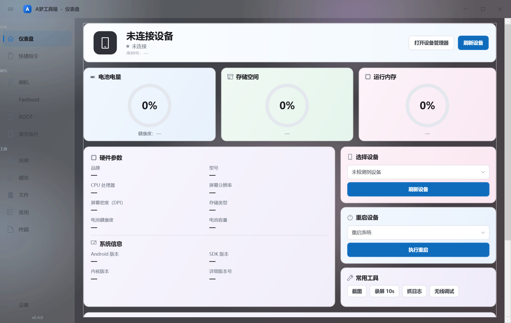

# A梦工具箱 桌面版（WPF）

原生 Windows 窗口程序，不是网页。界面参考 MemeKit / 拖把工具箱的排版：
左侧图标导航、顶部设备横幅、三张圆形指标卡、硬件与系统信息、右侧设备选择/
重启/常用工具。



## 功能

| 页面 | 能做什么 |
|---|---|
| 仪表盘 | 设备横幅、电量/存储/内存环形指标、硬件参数、系统信息、选择设备、重启、截图/录屏/日志/无线调试 |
| 快捷指令 | 重启、屏幕常亮、关闭动画、显示触摸、重启 ADB、驱动、无线调试、日志 |
| 刷机 | by-name 分区表、`dd` 备份、选择镜像还原（写入前确认） |
| Fastboot | 检测设备、预检、刷入分区、重启到系统 / bootloader / fastbootd |
| ROOT | root 状态、备份 boot / init_boot / vbmeta、打开 Magisk/KernelSU、安装 APK |
| 投屏 | 调用 scrcpy，可选分辨率 / 码率 / 置顶；scrcpy.exe 需自备 |
| 基带备份 | modem / fsg / persist 等分区的备份与还原 |
| 模块 | 读取 Magisk / KernelSU 模块，启用/禁用 |
| 文件 | 浏览、上传、拉取、重命名、删除、新建目录 |
| 应用 | 第三方 / 系统应用，冻结、解冻、清数据、提取、卸载 |
| 终端 | adb shell，root 开关，历史记录 |
| 设置 | adb 路径、目录、版本与关于 |

数据全部来自 `adb`（已随包附带），不经过任何本地网页服务。

## 运行

双击 `A梦工具箱.exe`。需要 Windows 10/11 自带的 .NET Framework 4.8（系统自带，不用装）。
程序以管理员权限运行（首次启动会弹 UAC），否则驱动安装、部分 adb/fastboot 操作会因为没有权限失败。
手机开 USB 调试并授权；root 相关功能需要 Magisk / KernelSU。

窗口是无边框自绘的：拖动标题栏移动、四边缩放、右上角最小化/最大化/关闭，
双击标题栏或按 F11 切换最大化。最大化按当前显示器的工作区计算，不会盖住任务栏；
最大化后按钮图标会变成「还原」。

最小化或点 ✕ 都只会把主界面隐藏到系统托盘（不再触发关闭动画，所以不会闪一下），
单击托盘图标会在「显示 / 隐藏」之间切换：界面开着时点一下收进托盘，隐藏时点一下恢复；
只有托盘菜单里的「退出」才真正结束进程。

收进托盘或退出时会中止本程序还在跑的 adb / fastboot 客户端；托盘「退出」还会执行
`adb kill-server`，不会留下 adb 在后台继续工作。文件页有「停止操作」按钮，
快捷指令里也有「停止 ADB」。

程序限制单实例：已经开着的时候再次双击 exe，不会开出第二个窗口，而是把已有窗口
唤到前台。

## 构建

```powershell
python desktop/build.py
```

产物：`dist/A梦工具箱/`（A梦工具箱.exe + adb + shots/backups）。
使用 .NET Framework 自带的 `csc.exe` 编译，不需要 Visual Studio、dotnet SDK 或 Gradle。

源码在 `desktop/src/`：

| 文件 | 作用 |
|---|---|
| `Program.cs` | 入口、`--shot` 离屏截图、`--smoke` 启动自检 |
| `MainWindow.cs` | 无边框窗口、标题栏、图标导航、页面切换 |
| `Dashboard.cs` | 仪表盘（横幅、指标环、硬件/系统信息、右侧卡片） |
| `Pages.cs` | 刷机 / 模块 / 文件 / 应用 / 设置 |
| `Theme.cs` | 颜色、字体、按钮、下拉框、进度环等控件 |
| `Adb.cs` | adb 调用、设备信息、备份/还原、模块与应用操作 |

`--shot out.png --demo` 可以把界面离屏渲染成 PNG，方便在没有浏览器/截图工具的
环境里检查排版。

## 说明

- 目前刷机页提供分区备份/还原；fastboot 刷写、EDL 还没做，不在这里假装可用。
- 备份写到 `backups/`，截图与日志写到 `shots/`，都在程序目录下。
- 设备信息每 10 秒刷新一次；su 只在首次读取时请求，避免反复弹授权框。
